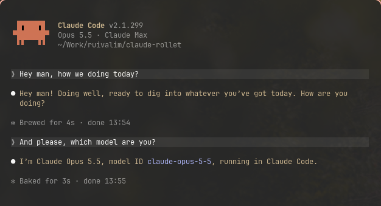
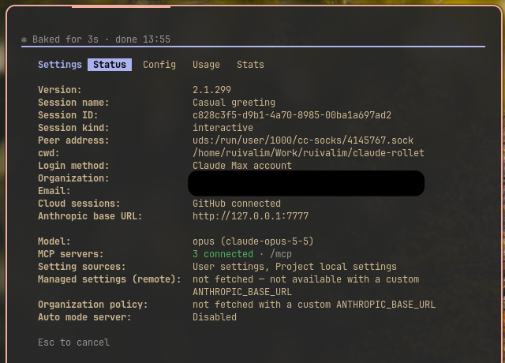
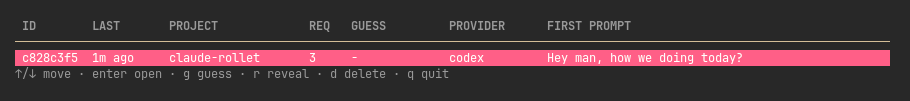

# claude-rollet

**Is Claude really the best model, or is Claude Code doing the heavy lifting?**

`rollet` is a local proxy for Claude Code. Every new session is silently routed to a
randomly chosen provider: Claude itself, Xiaomi MiMo, DeepSeek, ChatGPT, anything
OpenAI-compatible. Requests are translated on the fly, so Claude Code works as usual. It
never tells you which model you got. You just work, guess if you want, and reveal later.

It's a curiosity experiment: take the brand out of the equation and see whether you can
still tell.

```
claude ──► rollet (127.0.0.1:7777) ──┬──► Anthropic API     (passthrough, your own login)
                                     ├──► Xiaomi MiMo       (translated to Chat Completions)
                                     ├──► DeepSeek          (translated)
                                     └──► ChatGPT / any OpenAI-compatible endpoint
```

## What it looks like

Claude Code says Opus 5.5, and so does the model when you ask:



The only hint is the base URL in `/status`:



Then you reveal it. Same session: GPT on a ChatGPT subscription.



## How it stays blind

- **One roll per session.** The first request of a Claude Code session picks a provider
  (with `crypto/rand`), and the whole session sticks to it, including `--resume`.
- **Nothing on screen gives it away.** Responses carry the model name Claude Code asked
  for, the provider's reasoning shows up as regular "Thinking…", errors don't name the
  provider, and the server log prints `???` unless you run `serve --reveal`.
- **`rollet sessions` hides the provider** until you reveal that session. Once a session
  is revealed, guessing it is locked, so `rollet stats` only counts blind guesses.

## Install

**Download** (Linux and macOS, amd64 and arm64), checksum verified, into `~/.local/bin`:

```sh
curl -fsSL https://raw.githubusercontent.com/ruivalim/claude-rollet/main/install.sh | sh
```

**Let your agent do it.** Paste this into Claude Code (or Codex, Pi...):

> Install claude-rollet for me by following
> https://raw.githubusercontent.com/ruivalim/claude-rollet/main/AGENTIC_INSTALL.md

It installs the binary, asks which providers you want, writes the config, tests every
provider and sets up the service. See [AGENTIC_INSTALL.md](AGENTIC_INSTALL.md).

**From source** (Go 1.25+):

```sh
go install github.com/ruivalim/claude-rollet/cmd/rollet@latest
# or: git clone, then make install
```

Binaries are built by the release workflow whenever a `v*` tag is pushed.

## Quick start

```sh
rollet init                 # config + "put Claude in the roulette?" + add providers
rollet service install      # run 24/7 (systemd user unit on Linux, LaunchAgent on macOS)
```

Then pick how Claude Code reaches it:

```sh
rollet env >> ~/.zshrc      # every `claude` goes through the roulette (bash/fish/nu too: --shell)
rollet claude               # or opt in per session, without touching your env
```

If you export it globally and later stop the proxy, Claude Code can't connect. Remove
the line (or `rollet service uninstall` tells you to).

## The experiment

```sh
rollet sessions             # browse: enter opens, g guesses, r reveals, d deletes
rollet guess 3f2a mimo      # record your guess (prefix of the session id is enough)
rollet reveal 3f2a          # "It was claude (as requested). You guessed mimo. Wrong."
rollet stats                # your accuracy, exact provider and "Claude or not?"
rollet open 3f2a            # cd into that project and `claude --resume` it through rollet
```

## Providers and odds

```sh
rollet provider add         # form, model picker (from the provider's /models), then a live test
rollet provider test --all  # text, streaming, tool call + tool result, through the real proxy
rollet provider list        # weights and the actual chance of each provider
rollet odds 0.2             # Claude gets 20% of new sessions, the rest split by weight
```

`claude_odds` decides Claude vs. not-Claude first, then weights pick inside each group.
Without it, every provider competes by weight alone. Weight `0` pauses a provider without
deleting it. Config changes apply to a running proxy without a restart.

## Fake latency

Speed is the biggest tell. Thinking models chew on Claude Code's huge first prompt for a
while, then answer later turns quickly. A fast Claude next to them is obvious. `delay`
holds requests for a random time inside a range, separately for the first turn of a
session and for every later call:

```sh
rollet delay first 40-70s --provider claude   # slow Claude's first answer down
rollet delay between 1-4s --provider claude   # and add a little jitter after that
rollet delay between 0-2s                     # global: applies to every provider
rollet delay off --provider claude            # drop the override, back to the global one
```

Provider values override the global ones field by field, and `0` on a provider switches
a global delay off for it. The quota check Claude Code sends at startup is never delayed,
and a turn you cancel while it's being held never reaches the provider.

## Config

`~/.config/claude-rollet/config.json` (or `$ROLLET_HOME/config.json`), written with mode
0600 since it can hold keys. The session log sits next to it in `sessions.json`.

```json
{
  "listen": "127.0.0.1:7777",
  "claude_odds": 0.5,
  "providers": [
    { "name": "claude", "type": "anthropic", "base_url": "https://api.anthropic.com",
      "delay": { "first": "40-70s", "between": "1-4s" } },
    { "name": "mimo", "type": "mimo", "api_key": "sk-...", "model": "mimo-v2.5-pro" },
    { "name": "gpt", "type": "chatgpt", "api_key": "sk-...", "model": "gpt-5.5", "weight": 2 }
  ]
}
```

| Field | Meaning |
|---|---|
| `type` | `anthropic` (passthrough, no translation) or an adapter: `mimo`, `deepseek`, `chatgpt`, `codex`, `openai` (generic) |
| `base_url` | Optional for named adapters, required for `openai` and `anthropic` |
| `api_key` / `api_key_env` | Literal key, or an env var name. **Services don't see your shell env**, so prefer `api_key` for `rollet service`. An `anthropic` provider with no key forwards Claude Code's own login |
| `model`, `small_model` | `small_model` replaces `model` where Claude Code asks for a haiku model (titles, summaries) |
| `max_tokens` | Caps the output tokens Claude Code asks for (it asks for a lot) |
| `max_tokens_param` | `max_tokens` or `max_completion_tokens`; the adapter sets a sensible default |
| `extra_body` | Merged into every upstream request body, the escape hatch for provider knobs |
| `weight` | Relative chance, default 1, `0` pauses |
| `delay` | `{"first": "40-70s", "between": "1-4s"}` at the top level or per provider; see Fake latency |

## ChatGPT subscription (Codex login)

The `codex` provider uses your ChatGPT plan instead of an API key, signing in the same
way the Codex CLI does:

```sh
rollet codex login          # shows a code, approve it at auth.openai.com/codex/device
rollet provider add         # pick "ChatGPT subscription", then a model
```

rollet keeps its own login (`codex-auth.json`, next to the config) instead of reusing
`~/.codex/auth.json`: OpenAI rotates the refresh token on every renewal, so two programs
sharing one login keep logging each other out. It speaks the Responses API, carries the
model's encrypted reasoning between turns, and maps Claude Code's effort setting to
`reasoning.effort`.

## Adding a provider

Every adapter shares the same Anthropic Messages → Chat Completions translation
(`internal/translate`). A provider only needs a file in `internal/adapters/` with its
default URL, suggested models and a `Patch` for its quirks:

```go
func init() {
	register(Adapter{
		Type:    "acme",
		Label:   "Acme AI",
		BaseURL: "https://api.acme.ai/v1",
		Models:  []string{"acme-large"},
		Patch:   func(body map[string]any) { delete(body, "parallel_tool_calls") },
	})
}
```

Run `rollet provider add`, pick it, and the live test tells you whether text, streaming
and tool calls survive the round trip. PRs welcome.

## Known limitations

- **Context window.** Claude Code assumes Claude's window and compacts based on that. A
  long session on a model with a smaller window can fail with a context-length error.
- **Claude-only features** (server-side tools such as web search, prompt caching, effort
  levels) don't exist elsewhere. They are dropped, so WebSearch, for example, won't work
  on a non-Claude session.
- **Images** reach the provider as `image_url` parts; whether it understands them depends
  on the model.
- **`count_tokens`** is estimated (bytes / 4) for translated providers.
- **The blinding isn't perfect.** Ask a model who it is and it may tell you; speed and
  style are clues too. That's part of the game.
- **`codex` uses an undocumented backend.** It's the endpoint the Codex CLI itself talks
  to, so it works today but OpenAI can change it without notice, and those sessions spend
  your plan's usage limits.
- The macOS LaunchAgent is generated and validated as XML in tests, but hasn't been run
  on a Mac yet.

## Development

```sh
make            # list targets
make check      # lint + race tests + build, exactly what CI runs
make dist       # the release tarballs, exactly what the release workflow publishes
```

MIT licensed.
